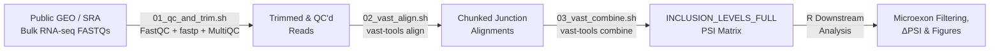

# Alternative Splicing of Microexons in Human Peripheral Tissues

[](https://doi.org/10.64898/2026.05.13.725022)
[](LICENSE)
[](#pipeline-overview)

A reproducible bioinformatics pipeline for quantifying and characterizing **microexon (3–27 nt) alternative splicing** from bulk RNA-seq cohorts across four human peripheral tissues: **lung, kidney, colon, and liver**.

---

## Pipeline Overview



---

## Datasets & Project Accessions

Publicly available bulk RNA-seq datasets spanning ten disease cohorts across four human peripheral tissues (**lung, kidney, colon, and liver**) were retrieved from NCBI BioProject and Gene Expression Omnibus (GEO). Sample-to-accession mappings and clinical group labels (`Disease` vs. `Control`) are documented in [`config/sample_metadata.tsv`](config/sample_metadata.tsv).

| Tissue | Disease Cohort | Abbr. | Accession ID | Repository |
| :--- | :--- | :--- | :--- | :--- |
| **Lung** | Small Cell Lung Cancer | SCLC | [`PRJNA257389`](https://www.ncbi.nlm.nih.gov/bioproject/PRJNA257389) | NCBI BioProject |
| **Lung** | Idiopathic Pulmonary Fibrosis | IPF | [`PRJNA358081`](https://www.ncbi.nlm.nih.gov/bioproject/PRJNA358081) | NCBI BioProject |
| **Lung** | Chronic Obstructive Pulmonary Disease | COPD | [`PRJNA24581`](https://www.ncbi.nlm.nih.gov/bioproject/PRJNA24581) | NCBI BioProject |
| **Lung** | Coronavirus Disease 2019 | COVID-19 | [`GSE183533`](https://www.ncbi.nlm.nih.gov/geo/query/acc.cgi?acc=GSE183533) | NCBI GEO |
| **Kidney** | Diabetic Nephropathy | DNE | [`PRJNA595590`](https://www.ncbi.nlm.nih.gov/bioproject/PRJNA595590) | NCBI BioProject |
| **Kidney** | Renal Cell Carcinoma | RCC | [`PRJNA704974`](https://www.ncbi.nlm.nih.gov/bioproject/PRJNA704974) | NCBI BioProject |
| **Colon** | Colorectal Cancer | CC | [`PRJNA218851`](https://www.ncbi.nlm.nih.gov/bioproject/PRJNA218851) | NCBI BioProject |
| **Colon** | Ulcerative Colitis | UC | [`PRJNA1019284`](https://www.ncbi.nlm.nih.gov/bioproject/PRJNA1019284) | NCBI BioProject |
| **Liver** | Hepatic Cellular Carcinoma | avHCC; eHCC; LC; DN; CH | [`PRJNA471801`](https://www.ncbi.nlm.nih.gov/bioproject/PRJNA471801) | NCBI BioProject |
| **Liver** | Non Alcoholic Fatty Liver Disease | NAFLD | [`PRJNA558102`](https://www.ncbi.nlm.nih.gov/bioproject/PRJNA558102) | NCBI BioProject |

---

## Repository Structure

```text
Alternative-splicing-of-microexons-in-peripheral-tissues/
├── README.md
├── LICENSE
├── environment.yml                 # Conda environment for QC & preprocessing
├── config/
│   └── sample_metadata.tsv         # Cohort sample manifest (GROUP, SAMPLE, READ1, READ2, ACCESSION)
├── scripts/
│   ├── 01_qc_and_trim.sh           # FastQC, fastp adapter/quality trimming, and MultiQC
│   ├── 02_vast_align.sh            # VAST-TOOLS align wrapper (SLURM array or sequential)
│   └── 03_vast_combine.sh          # VAST-TOOLS combine to generate merged PSI inclusion tables
├── example_data/                   # Subsampled toy data for local verification
└── results/
    └── figures/                    # Output plots
```

---

## Prerequisites & Setup

### 1. Preprocessing & QC Environment
```bash
git clone [https://github.com/shalinirmn/Alternative-splicing-of-microexons-in-peripheral-tissues.git](https://github.com/shalinirmn/Alternative-splicing-of-microexons-in-peripheral-tissues.git)
cd Alternative-splicing-of-microexons-in-peripheral-tissues

conda env create -f environment.yml
conda activate microexon-splicing
```

### 2. VAST-TOOLS & VASTDB Setup
Splicing quantification relies on `vast-tools` and the human `VASTDB` library (`Hsa` / `Hs2`).
1. Install `vast-tools` following the official [vast-tools repository instructions](https://github.com/vastgroup/vast-tools).
2. Download the human species database (`vastdb.hsa.*.tar.gz` or `vastdb.hs2.*.tar.gz`) directly from the [CRG VASTDB Library Archive](https://vastdb.crg.eu/libs/) and extract it into your `vast-tools/VASTDB/` directory.
---

## Step-by-Step Execution

### Step 1: Quality Control & Adapter Trimming
After retrieving paired-end FASTQs from the project accessions above, run `FastQC`, adapter/low-complexity trimming via `fastp` (`-l 36`, `--average_qual 20`), and aggregate reports with `MultiQC`:
```bash
bash scripts/01_qc_and_trim.sh /path/to/raw_fastq results/qc_out
```

### Step 2: Splicing Alignment (`vast-tools align`)
Align trimmed paired-end reads (`*_1_trim.fq.gz` and `*_2_trim.fq.gz`) against `VASTDB` (`Hs2`):
```bash
bash scripts/02_vast_align.sh results/qc_out/fastp_out vast_align
```

### Step 3: Merge Cohort PSI Tables (`vast-tools combine`)
Combine per-sample junction alignments into the master `INCLUSION_LEVELS_FULL` PSI matrix:
```bash
bash scripts/03_vast_combine.sh vast_align Hsa
```

### Step 4: Downstream R Analysis *(Next)*
R scripts for microexon length filtering (`3–27 nt`), read-coverage quality filtering, differential splicing ($\Delta\text{PSI}$), cross-tissue comparison, and figure generation will be documented here.

---

## Citation

If you use this pipeline or data in your work, please cite:

> Raman, S., & Gupta, I. (2026). *In silico investigation of alternative splicing of microexons in human peripheral tissues*. bioRxiv. https://doi.org/10.64898/2026.05.13.725022
